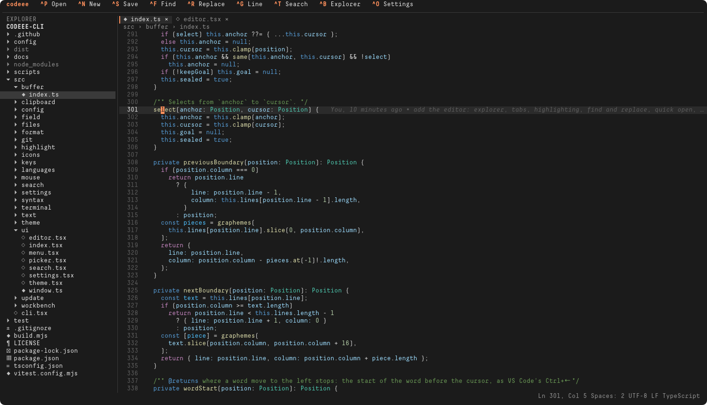
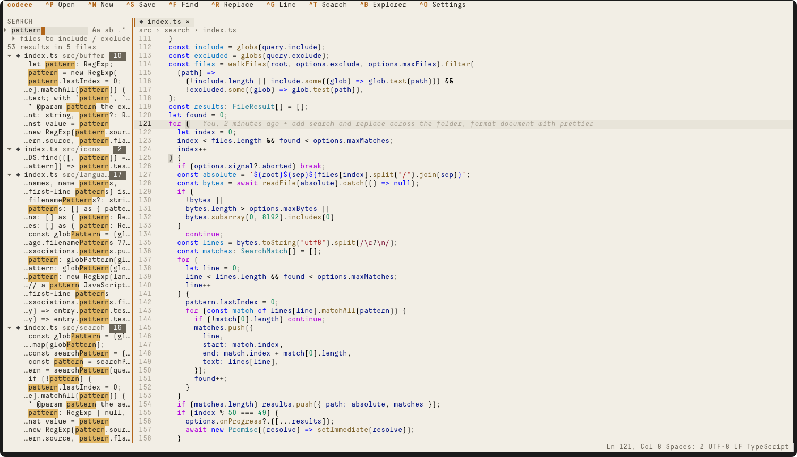

# codeee

**A code editor for the terminal, after VS Code.** A file explorer with your VS Code icons and git states, tabs, syntax highlighting in your VS Code theme for every language, find and replace in a file and across the folder, Quick Open, a settings page like VS Code's, Prettier formatting, the current line's blame, and full mouse support.

[](https://github.com/illinifellow/codeee-cli/actions/workflows/ci.yml)
[](https://github.com/illinifellow/codeee-cli/actions/workflows/ci.yml)
[](https://github.com/illinifellow/codeee-cli/actions/workflows/ci.yml)
[](LICENSE)
[](https://nodejs.org)
[](https://buymeacoffee.com/illinifellow)



codeee is the sibling of [gittt](https://github.com/illinifellow/gittt-cli): gittt is a Sourcetree for the terminal, codeee is a VS Code for it. It is an editor and nothing more: no extensions, no built-in terminal, no debugger. What VS Code users reach for every minute is built in.



## Features

- **Explorer:** the folder's tree with the icons of your VS Code icon theme, git states (modified, untracked, added, deleted, conflicted, ignored) and unsaved files; new file, new folder, rename, delete to the Trash, copy path.
- **Tabs and Quick Open:** files open in tabs and come back next time with their cursor where you left it; `^P` finds any file by fuzzy name, `:` goes to a line, `>` runs any command.
- **Highlighting:** every language shiki bundles (over 240), found the way VS Code finds them (its installed language extensions, file names, shebangs), coloured by your VS Code theme with your `editor.tokenColorCustomizations`.
- **Editing as in VS Code:** auto-indent, auto-closing brackets and quotes, word moves and deletes, Tab and Shift+Tab on selections, line comments, move, copy and delete lines, whole-line copy and paste, undo and redo grouped by typing.
- **Find and replace:** in the file with case, whole-word and regular-expression options; across the folder in the Search view with files to include and exclude, and Replace All.
- **Format Document** with Prettier: the project's Prettier and configuration, or the one the VS Code extension bundles, so the result is what VS Code gives. Optional format on save.
- **From neovim:** lines kept around the cursor while scrolling, relative line numbers, jump to the matching bracket, the last cursor position of every file.
- **From VS Code extensions:** the current line's blame (GitLens), colour literals drawn on their colour (Color Highlight).
- **Settings page** like VS Code's: search, table of contents, every option with its description and control, modified marks, reset, and the JSON file one click away.
- **Mouse everywhere:** click, double-click to select a word, drag to select, wheel, right-click menus, a draggable explorer edge.

## Requirements

- Node.js 22.15+; `git` for the explorer's states and the blame.
- A terminal with true colour, SGR mouse reporting and bracketed paste; tested in iTerm2 on macOS. The screenshots use the Decima Mono X font.

## Install

```sh
npm install --global https://github.com/illinifellow/codeee-cli/releases/latest/download/codeee-cli.tgz
```

**Update** appears in the toolbar when a newer release exists; a click installs it and restarts in place. From a clone:

```sh
git clone https://github.com/illinifellow/codeee-cli.git
cd codeee-cli
npm install
npm link
```

## Run

```sh
codeee              # asks which folder to open, prefilled with the current one
codeee ~/code/app   # prefills that folder instead
codeee src/app.ts   # opens the file's folder with the file in a tab
```

## Keyboard

| Key                 | Action                                                      |
| ------------------- | ----------------------------------------------------------- |
| `^S` `^N` `^W` `^Q` | save, new file, close tab, quit (asks about unsaved files)  |
| `^P`                | Quick Open: files; `:` line; `>` commands                   |
| `^G`                | go to line                                                  |
| `^F` `^R`           | find, replace in the file                                   |
| `F3` `⇧F3`          | next, previous match; the word at the cursor with no search |
| `^T` `⌥^T`          | search, replace across the folder                           |
| `⌥C` `⌥W` `⌥R`      | match case, whole word, regular expression                  |
| `^Z` `^Y`           | undo, redo                                                  |
| `^C` `^X` `^V`      | copy, cut, paste (the whole line when nothing is selected)  |
| `^A` `^L`           | select all, expand line selection                           |
| `^/` `^K` `^D`      | toggle comment, delete line, copy line down                 |
| `⌥↑` `⌥↓`           | move line                                                   |
| `^\`                | jump to the matching bracket                                |
| `⌥⇧F`               | Format Document                                             |
| `^B` `^E`           | toggle the explorer, focus it                               |
| `^O`                | settings                                                    |
| `^PgUp` `^PgDn`     | previous, next tab                                          |
| `^←` `^→` `⌥←` `⌥→` | word left, right; with `⇧` select                           |

Every key is set in the settings. Terminals do not pass Cmd to programs; map a Cmd shortcut to one of these in the terminal's key settings to keep your VS Code habits.

## Configuration

The settings page (`^O`) holds every option. Configuration is `settings.json` in two files of one shape:

| File                                    | Holds                                                      |
| --------------------------------------- | ---------------------------------------------------------- |
| `config/settings.json` (in the package) | every default: settings, limits, keys, themes              |
| `~/.config/codeee-cli/settings.json`    | your changes, plus `state` (recent folders, tabs, cursors) |

### Themes

**golden-brown** is dark, warm orange on brown, drawn on the terminal's background; **milk-and-honey** is light, milky with amber. They are gittt's themes; their code colours come from your VS Code theme and from light-plus. `settings.theme` defaults to `auto`, which picks one by the terminal's background; `vscode` takes every colour from the theme VS Code runs, with its `workbench.colorCustomizations`.

## Development

```sh
npm install
npm run build       # dist/app.js and the dist/cli.js launcher
npm run typecheck
npm test
```

In a checkout, `codeee` restarts in place when `dist/app.js` changes and no file is unsaved.

## Contributing

Every change starts as a [bug report](https://github.com/illinifellow/codeee-cli/issues/new?template=bug_report.yml) or a [feature request](https://github.com/illinifellow/codeee-cli/issues/new?template=feature_request.yml), is worked on its own branch, and lands through a pull request that closes the issue.

## License

[MIT](LICENSE)
